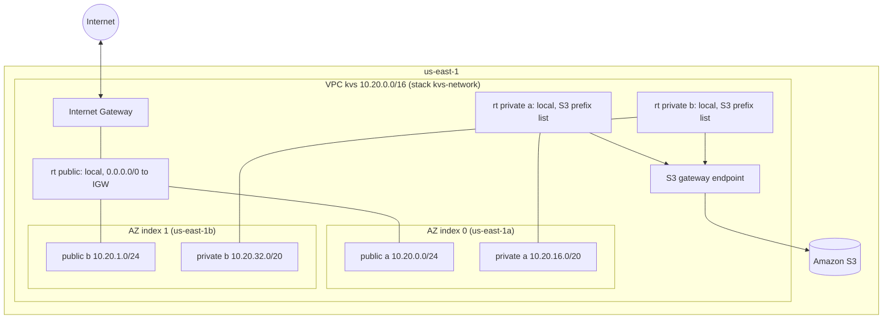

# Architecture: light serverless key-value store (state after M1)

## 1. M1 diagram



ASCII версія для терміналу:

```
                         Internet
                            |
                     [Internet Gateway]
 VPC 10.20.0.0/16           |
 +--------------------------+------------------------------+
 | AZ a                     |                 AZ b         |
 | public 10.20.0.0/24  <---rt-public--->  public 10.20.1.0/24
 |                                                         |
 | private 10.20.16.0/20   (rt-private-a)                  |
 |                         private 10.20.32.0/20 (rt-private-b)
 |       \___________ S3 gateway endpoint _____________/   |
 +---------------------------------------------------------+
 Not deployed: kvs-iam-readonly (policy + role), real account only.
 Reserved: AZ c 10.20.2.0/24 + 10.20.48.0/20, data tier 10.20.64.0/18, 10.20.128.0/17.
```

## 2. Resource inventory (M1)

| Stack | Resource | Count | Cost |
|---|---|---|---|
| kvs-network | VPC | 1 | безкоштовно |
| kvs-network | Subnets (2 public /24, 2 private /20) | 4 | безкоштовно |
| kvs-network | Internet gateway + attachment | 1 | безкоштовно (передача даних оплачується) |
| kvs-network | Route tables (1 public, 2 private) + 4 associations + 1 default route | 3 | безкоштовно |
| kvs-network | S3 gateway endpoint | 1 | безкоштовно |
| kvs-network | NAT gateway + EIP (лише якщо `EnableNatGateway=true`) | 0 | приблизно $36.50 на місяць, якщо ввімкнено |
| kvs-iam-readonly | Managed policy `kvs-readonly-view`, role `kvs-readonly-viewer` | 0 у sandbox | безкоштовно, тут не можна задеплоїти |

Деталі кожного logical ID, параметра і export є в `docs/m1-design-decisions.md` §3 і §4.

## 3. How it grows in M2 to M5

Я планую це так уже зараз, щоб мережу ніколи не треба було змінювати руйнівно. Кожен крок це рішення для M2+ з власним ADR, а те, що написано тут, це мій поточний намір, а не зобов'язання.

| Milestone | Що додається | Де це лягає в мережі |
|---|---|---|
| M2 sharding | stack `kvs-app`, який імпортує exports з `kvs-network`. Coordinator (public subnet, або за ALB чи HTTP API) і 2 shard вузли в private subnets, по одному на AZ. Security groups: SG coordinator дозволяє порт API з інтернету або з SG ALB, SG shard дозволяє порт shard лише з SG coordinator. CI/CD розгортає `kvs-app` через change sets. | private a і b, public a для точки входу |
| M3 replication | 3 replicas на shard. Я додаю AZ c (`10.20.2.0/24`, `10.20.48.0/20`) через оновлення stack, щоб кожна replica була у своїй AZ. Replication log іде в S3 через наявний gateway endpoint, або в broker у private tier. Cross-AZ трафік стає справжньою статтею витрат. | private a, b, c, необов'язковий data tier `10.20.64.0/18` |
| M4 observability | CloudWatch metrics, logs і alarms, VPC Flow Logs у S3. Якщо private tier потребує CloudWatch без NAT, interface endpoints для `logs` і `monitoring`. MCP server поруч з coordinator. | private tier, endpoints у private subnets |
| M5 production | Autoscaling вузлів shard за p99 latency, rebalancing job, health endpoints. Запас адрес 4 091 на private subnet це покриває. | private tier |

## 4. Security model

- **Identity.** Sandbox дає мені дві roles: role моєї сесії CLI або консолі (очікувано `voclabs`) і `LabRole`, яку я передаю в EC2 або Lambda. Я не можу створювати там roles чи policies. Read-only policy з мінімальними правами і assumable role існують як код у `infra/iam-readonly.yaml` для реального акаунта, з умовою ExternalId, необов'язковим MFA, і з policy, повторно використаною як permissions boundary, щоб role ніколи не могла вийти за межі перегляду.
- **Layers of policy evaluation.** Organization SCP від провайдера sandbox, потім identity policies, потім resource policies, і явний deny завжди перемагає. Що LabRole дозволяє і забороняє записано в `docs/labrole.md` разом з методом, яким знайдено кожну знахідку.
- **Network.** Private subnets не мають маршруту в інтернет в жодному напрямку, і я можу це показати в route tables. Вхідний трафік з інтернету може досягти лише public subnets. Починаючи з M2, security groups посилаються одна на одну за ID замість CIDR, тож порти shard відкриті лише для coordinator.
- **Change control.** Кожна зміна йде через CloudFormation change set. Drift detection ловить ручні зміни в консолі. Тег `ManagedBy=cloudformation` позначає ресурси, які не можна чіпати вручну.
- **Known gaps.** Default security group у VPC все ще дозволяє весь трафік між своїми членами, бо CloudFormation не керує її правилами легко. Я нічого в неї не кладу. S3 endpoint використовує default policy з повним доступом, і я звужу її до свого bucket і bucket з репозиторієм Amazon Linux у M2. Flow Logs не буде до M4.

## 5. Cost model

Мережа M1 коштує $0 на місяць у такому вигляді, як задеплоєно, бо нічого в ній не рахується за годину. Єдиний перемикач, який коштує грошей, це `EnableNatGateway`, приблизно $36.50 на місяць разом з його public IPv4. Прогноз M2 з 2 shards є в `docs/m1-budget-and-quotas.md`. Мій baseline (3 x t3.micro, без NAT) це приблизно $30 на місяць завжди ввімкнено і приблизно $7 на місяць у режимі lab-hours, проти припущеного кредиту курсу $50, тож починаючи з M2 я планую запускати compute лише під час сесій і відбудовувати його з IaC.
